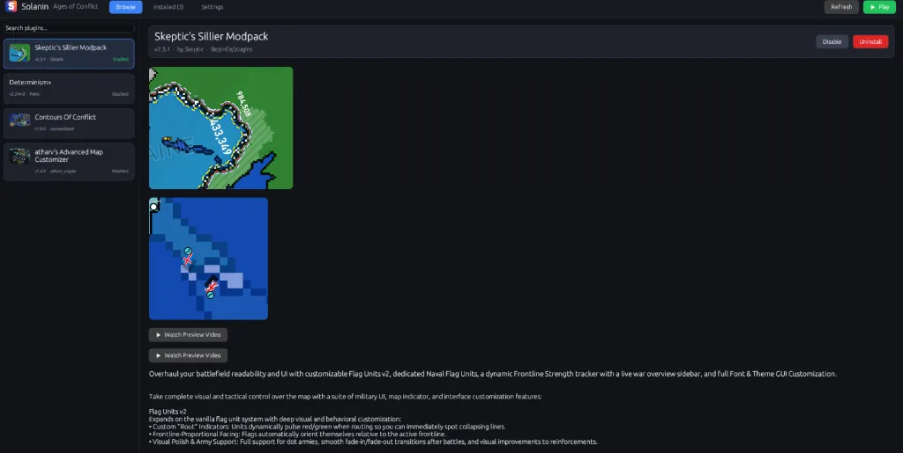

<p align="center">
  
</p>

<h1 align="center">Solanin</h1>

<p align="center">
  A lightweight, cross-platform plugin launcher for <strong>Ages of Conflict: World War Simulator</strong> (Linux AppImage &amp; Windows <code>.exe</code>).
</p>

---

## Preview (v1.0.0)
> **Note:** This is **v1.0.0** — more mods are going to be added!




## Features
- **Automatic BepInEx 5 Setup**: Checks for `BepInEx` on startup and automatically installs the right build for Windows or Linux (`5.4.23.6`) into your Steam game folder.
- **Steam Auto-Detection**: Reads Steam's `libraryfolders.vdf` and `appmanifest_2186320.acf` to locate *Ages of Conflict World War Simulator* automatically.
- **Browse & Install Plugins**: Fetches `catalog.json` (with offline caching), previews plugin images and descriptions, and installs `.zip` or `.dll` plugins into `BepInEx/plugins`.
- **Enable / Disable Anytime**: Toggling a plugin off removes its files from `BepInEx/plugins` while keeping them staged locally for instant re-enabling.

## Download
Grab the latest **`solanin-x86_64.AppImage`** (Linux) or **`solanin.exe`** (Windows) from [Releases](https://github.com/omarxi/Solanin/releases).

## Building from Source
Requires [Rust](https://rustup.rs/):
```bash
cargo run --release
```

### Linux AppImage
```bash
chmod +x scripts/build-appimage.sh
./scripts/build-appimage.sh
```

### Windows `.exe` (cross-compile from Linux)
Requires `mingw-w64` (`x86_64-w64-mingw32-gcc`):
```bash
chmod +x scripts/build-windows.sh
./scripts/build-windows.sh
```
